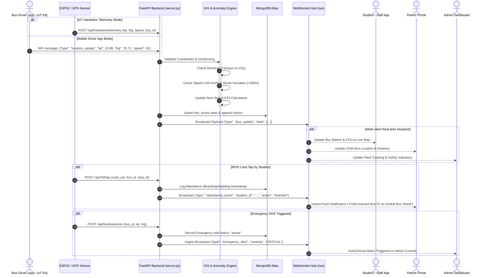
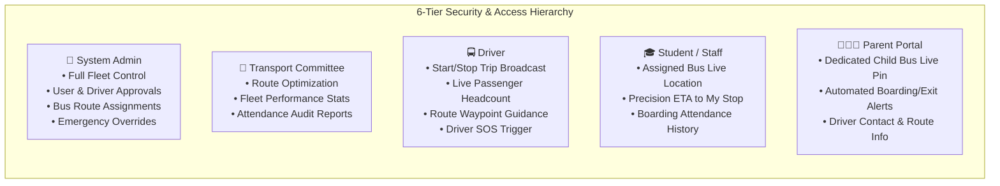

# System Architecture Documentation — KRCE Bus Tracking System v3.2.0

> **Institution**: K. Ramakrishnan College of Engineering (KRCE), Samayapuram, Tiruchirappalli  
> **System Version**: 3.2.0 (Production Ready)  
> **Documentation Type**: Complete System Architecture & Data Flow

---

## 1. High-Level System Architecture Diagram

```mermaid
graph TB
    %% ==========================================
    %% IOT HARDWARE SUBSYSTEM
    %% ==========================================
    subgraph IoT_Hardware ["📡 IoT Hardware Layer (Bus Kit)"]
        direction TB
        ESP32["ESP32 Microcontroller<br/>(Dual Core / FreeRTOS)"]
        NEO6M["NEO-6M GPS Module<br/>(NMEA 9600 baud)"]
        RC522["RC522 RFID Reader<br/>(13.56 MHz SPI)"]
        SIM900["SIM900A GPRS Modem<br/>(HTTP POST / GSM)"]
        SOS_BTN["Physical Panic Button<br/>& Active Buzzer"]
        
        NEO6M -->|NMEA Sentences| ESP32
        RC522 -->|Card UID Tap| ESP32
        SOS_BTN -->|GPIO Interrupt| ESP32
        ESP32 -->|AT Commands| SIM900
    end

    %% ==========================================
    %% CLIENT LAYER
    %% ==========================================
    subgraph Client_Layer ["📱 Client Applications Layer"]
        direction TB
        
        subgraph Native_Android ["Native Android App (Kotlin / Compose)"]
            Android_Driver["Driver View & GPS Foreground Service"]
            Android_Student["Student / Staff Live Map"]
            Android_Parent["Parent Portal & Attendance"]
            Android_Admin["Admin Management Dashboard"]
        end

        subgraph Flutter_App ["Cross-Platform App (Flutter / Dart)"]
            Flutter_Map["flutter_map (OSM Tiles)"]
            Flutter_Driver["Driver Location Broadcaster"]
            Flutter_Parent["Parent Ward Tracking"]
            Flutter_Admin["Fleet Admin Console"]
        end

        subgraph Web_App ["Web Dashboard (Vanilla JS / Leaflet)"]
            Web_Admin["Admin Control Center"]
            Web_Parent["Parent Web Portal"]
            Web_LiveMap["Interactive Leaflet OSM Map"]
        end
    end

    %% ==========================================
    %% API GATEWAY & APPLICATION BACKEND
    %% ==========================================
    subgraph Backend_Layer ["⚡ Backend Application Layer (FastAPI / Python 3.10+)"]
        direction TB
        
        Uvicorn["Uvicorn ASGI Server<br/>(Port 8000 / Production Railway)"]
        FastAPI_Core["FastAPI Application Core (server.py)"]
        
        subgraph API_Routers ["API Routing & Controllers"]
            R_Auth["/api/auth & /api/my<br/>(JWT & RBAC Security)"]
            R_Buses["/api/buses<br/>(Live GPS, Routes, Stops)"]
            R_Driver["/api/driver<br/>(Broadcast & Trip Status)"]
            R_RFID["/api/rfid<br/>(Tap & Attendance Logging)"]
            R_Emergencies["/api/emergencies<br/>(Panic / SOS Alerting)"]
            R_Hardware["/api/hardware<br/>(IoT Telemetry Ingestion)"]
            R_Admin["/api/admin<br/>(Fleet Control & Approvals)"]
            R_WS["/ws<br/>(Real-Time WebSocket Hub)"]
        end

        subgraph Business_Engines ["Core Business Logic & Intelligence Engines"]
            GIS_Engine["GIS & Geofencing Engine<br/>• Haversine Spherical Distance<br/>• Geofence In/Out Detection<br/>• Auto Direction Detection"]
            Safety_Engine["Safety & Anomaly Engine<br/>• Overspeed Alert (>60 km/h)<br/>• Route Deviation (>500m)<br/>• Vehicle Idling (>5 min)<br/>• GPS Stale Heartbeat Filter"]
            AI_Engine["Heuristic & Prediction Engine<br/>• Traffic-Aware ETA Estimator<br/>• Delay Forecaster<br/>• Stop Passenger Demand ML<br/>• Seat Occupancy Tracker"]
            WS_Manager["WebSocket Connection Manager<br/>(Thread-safe async broadcast pool)"]
        end

        Uvicorn --> FastAPI_Core
        FastAPI_Core --> API_Routers
        API_Routers --> Business_Engines
    end

    %% ==========================================
    %% DATABASE LAYER
    %% ==========================================
    subgraph Data_Layer ["💾 Persistent Data & Fallback Layer"]
        direction TB
        MongoDB[("MongoDB Atlas (Cloud NoSQL)<br/>• users, buses, routes, stops<br/>• attendance, emergencies<br/>• audit_logs, telemetry_logs")]
        MockDB[("In-Memory Async Mock DB<br/>(Zero-Config Offline Fallback)")]
    end

    %% ==========================================
    %% EXTERNAL SERVICES
    %% ==========================================
    subgraph External_Services ["🌐 External Cloud & GIS Services"]
        direction TB
        OSRM["OSRM Routing Engine<br/>(Road Network & Turn-by-Turn)"]
        OSM_Tiles["OpenStreetMap Tile Server<br/>(Standard Carto Style)"]
    end

    %% ==========================================
    %% COMMUNICATIONS & DATA FLOW
    %% ==========================================
    SIM900 -->|HTTP POST Telemetry / RFID / SOS| R_Hardware
    SIM900 -->|HTTP POST Attendance Tap| R_RFID

    Android_Driver -->|WebSocket GPS Stream| R_WS
    Android_Driver -->|REST API Status| R_Driver
    Flutter_Driver -->|WebSocket GPS Stream| R_WS
    Flutter_Driver -->|REST API Updates| R_Driver

    R_WS -->|Sub-second Real-Time Broadcast| Android_Student
    R_WS -->|Sub-second Real-Time Broadcast| Android_Parent
    R_WS -->|Sub-second Real-Time Broadcast| Android_Admin
    R_WS -->|Sub-second Real-Time Broadcast| Flutter_Map
    R_WS -->|Sub-second Real-Time Broadcast| Web_LiveMap

    Client_Layer -->|HTTP REST Requests (Auth, History, Profile)| API_Routers

    Business_Engines -->|Motor AsyncIOMotorClient| MongoDB
    Business_Engines -.->|Fallback if Mongo Offline| MockDB
    GIS_Engine -->|Map Match & Geometry| OSRM
    Client_Layer -->|Tile Fetching| OSM_Tiles
```

---

## 2. Real-Time Telemetry & Event Sequence Diagram



---

## 3. Layered Architectural Decomposition

| Layer | Component | Technologies | Primary Responsibilities |
|---|---|---|---|
| **1. Perception & IoT** | Smart Bus Kit | ESP32, NEO-6M, RC522, SIM900A, Piezo Buzzer | Raw GNSS coordinate collection, RFID card UID reads, panic switch handling, GPRS HTTP POST dispatch. |
| **2. Edge & Client** | Native Android | Kotlin, Jetpack Compose, Retrofit, OSMDroid | Foreground location service for drivers, sub-second map rendering, parent monitoring, offline state caching. |
| | Mobile Flutter | Dart, Flutter 3.x, flutter_map, Provider/Riverpod | Cross-platform compatibility (Android & iOS), student route selection, push alerts, ward tracking. |
| | Web Frontend | HTML5, Modern CSS (Glassmorphism), Leaflet.js | Administrative control center, fleet overview, route builder, user approval management, parent web tracking. |
| **3. API Gateway** | Application Server | FastAPI, Uvicorn, Python 3.10+ | ASGI async request handling, JWT authentication, role verification (RBAC), WebSocket connection pool. |
| **4. Intelligence** | Processing Engines | Python, Haversine, OSRM, Scikit/Heuristics | Geofence arrival/departure detection, traffic-weighted ETA, overspeed/route anomaly detection, occupancy forecasting. |
| **5. Data & Storage** | Persistence Layer | MongoDB Atlas, Motor (AsyncIOMotorClient) | NoSQL document storage for users, vehicles, routes, geofences, RFID attendance logs, emergency audit trails. |
| **6. Cloud & Network** | Hosting & GIS | Railway PaaS, OpenStreetMap, OSRM Cloud | High-availability hosting with persistent WebSocket support, live map tile distribution, road routing graph. |

---

## 4. Role-Based Access Control (RBAC) Architecture


